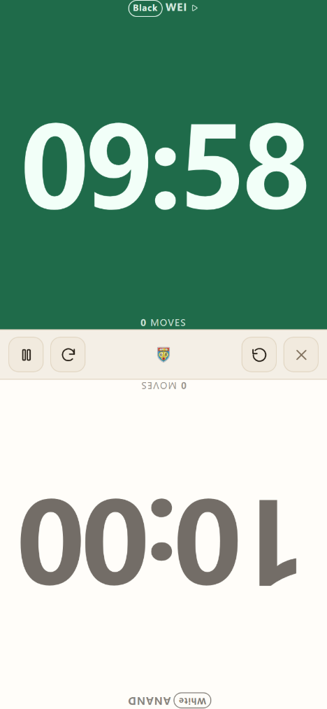
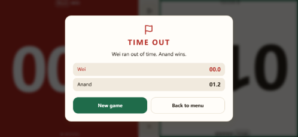
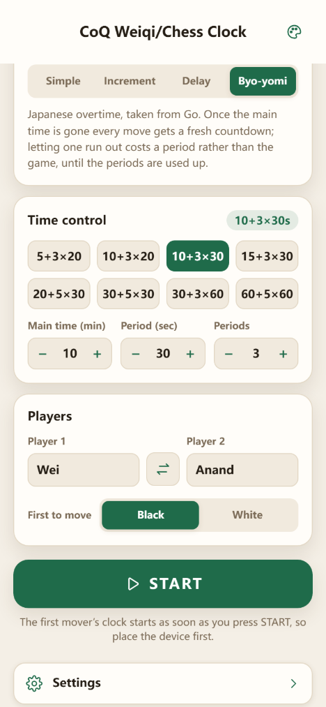
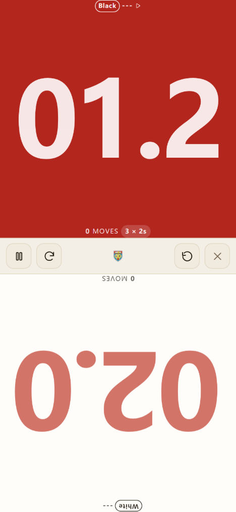
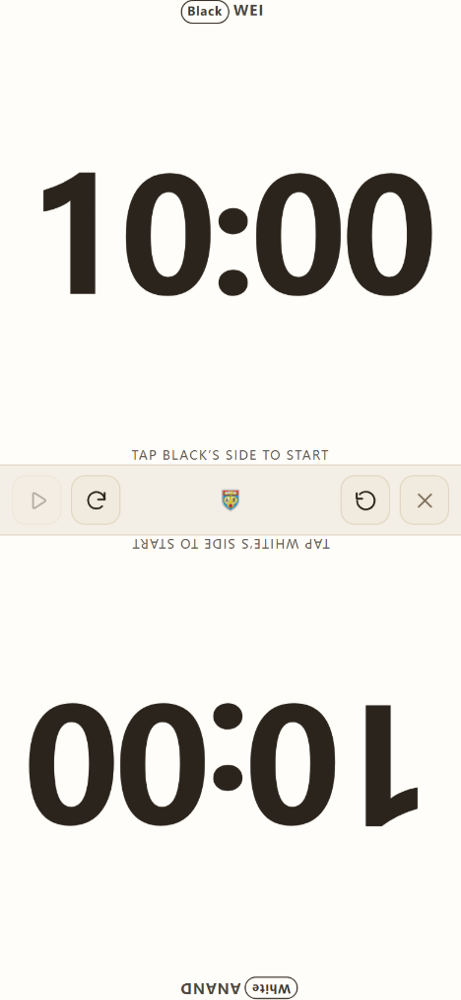
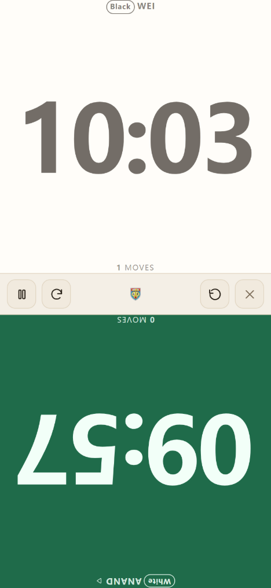
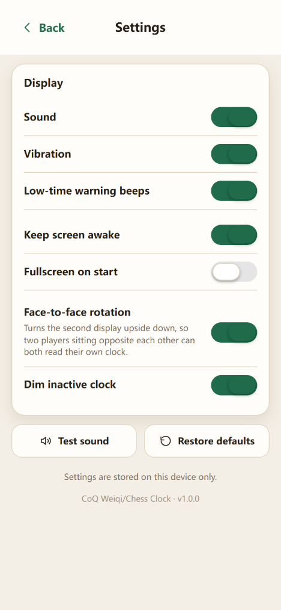
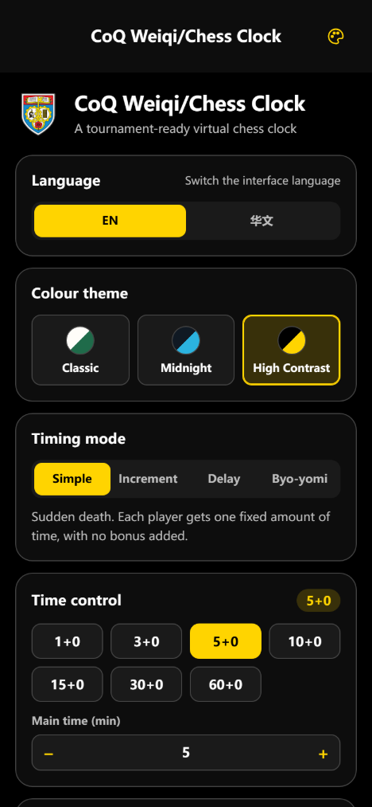

**English** · [华语](README_CHN.md)

# CoQ Weiqi/Chess Clock

A two-player **virtual chess clock** for community and inter-school tournaments —
with the byo-yomi overtime used in Go — built with plain **HTML5 + CSS +
JavaScript** on the **Framework7** framework.

It runs from a local file on a PC, from a small local server that phones on the
same wifi can open, or from any static web host.






---

## 1. What a real tournament clock does — and what this app reproduces

Before writing any code it is worth being precise about the device being copied.
A match clock is not "two stopwatches"; it is a small state machine with a few
non-obvious rules. Those rules are what this app implements.

| Physical clock behaviour | Why it matters in a game | In this app |
| --- | --- | --- |
| Two countdown timers, **interlocked** | Exactly one clock may run at any instant, otherwise the players lose time unevenly | `ChessClock` engine guarantees a single running side |
| Pressing your **own** lever stops your clock and starts your opponent's | The lever is the move; handing over is the whole interaction | Tap **your own half** of the display |
| A tap on the wrong lever does nothing | The opponent must not be able to bank time by tapping your side | Taps on the idle half are ignored |
| **Move counter** | Lets an arbiter reconstruct a game and spot an illegal press | Each half counts its own presses |
| **Flag fall** — the moment a clock reaches zero | Decides games; must be unmistakable and instant | Red half, `TIME OUT` overlay, alarm sound, vibration |
| **Fischer increment** (+N seconds per move) | The modern tournament standard; rewards playing on | Timing mode `Increment` |
| **Bronstein delay** (N free seconds per move) | Protects a player who is short of time but still moving fast | Timing mode `Delay` |
| **Sudden death** | The simplest control for beginners | Timing mode `Simple` |
| **Byo-yomi** (N periods of X seconds) | The Go overtime system, where losing a period is a warning rather than a loss | Timing mode `Byo-yomi` |
| RUN/PAUSE switch for the arbiter | Disputes, toilet breaks, board repairs | Pause button, plus the Space bar on a PC |
| **Tournament presets** on the dial | Nobody wants to set 90+30 by hand | Preset grid per mode, plus custom minutes/seconds |
| Low-time readability | The last ten seconds are where games are decided | Digits switch to tenths under 20 s, then go amber, then red and pulse |
| Sits flat **between** the two players | Both players must read their own display | Landscape or portrait, second display rotated 180° |
| Battery, and staying awake | A phone that sleeps mid-game is worse than no clock | Screen Wake Lock, and an offline cache so no network is needed |

Deliberately **out of scope**: Canadian (block) overtime — the Japanese
period form is the one implemented — plus game records, round pairing,
chessboard clocks, and certified timing accuracy for rated events.

---

## 2. Quick start

### On a PC

Either open the file directly:

```text
index.html          <- double-click it
```

or serve the folder and visit the printed address:

```bash
npm install     # only needed for Framework7's source and the dev tools
npm start       # http://localhost:8080
```


### On a phone or tablet

1. Start the server on the PC with `npm start`.
2. The server prints every LAN address, for example `http://192.168.1.20:8080`.
3. Open that address on the phone — both devices must be on the same wifi.
4. Use **Add to Home Screen** for a fullscreen, offline-capable app.

### Hosting it online

Upload the folder (minus `node_modules`) to any static host — GitHub Pages,
Netlify, an intranet share, anything that serves files. There is no build step
and no server-side code. It also works from a subfolder, because every path in
`index.html` is relative.

---

## 3. The four timing modes

| Mode | Behaviour | Typical use |
| --- | --- | --- |
| **Simple** | One fixed amount of time each, no bonus. The first clock to reach zero flags. | School and beginner events |
| **Increment (Fischer)** | The player who has just moved receives +N seconds. The bonus is credited **after** the move, exactly as a digital clock does. | 3+2, 5+3, 10+5, 90+30 — the modern standard |
| **Delay (Bronstein)** | Every move begins with N free seconds. The main clock only starts running once that head start is used up; move within it and nothing is consumed. | 10+5d, 25+5d — protects a short-of-time player |
| **Byo-yomi** | Japanese overtime, taken from Go. Once the main time is gone, every move gets a fresh countdown of X seconds, and each player holds N periods. Using a period up costs that period, not the game; the move simply restarts with the next one. Running out of periods is a loss. | 10+3×20s, 30+5×30s — for organisers who also run Go, or who want a gentler overtime than sudden death |

Presets are offered for each mode, and any main time (1–180 min) with any bonus
(0–600 s) can be set by hand. The chosen control is remembered on the device.





### How the clock is kept honest

Timing is derived from monotonic timestamps (`performance.now()`) rather than
from accumulated timer ticks. This matters on a phone: `requestAnimationFrame`
is throttled to nothing while the screen is off or the tab is in the
background, but the elapsed wall time is still measured correctly the moment
the page wakes up. A backgrounded clock can therefore never silently gain time,
and a flag that fell while the screen was asleep is reported as soon as the
page returns.

The engine is covered by a deterministic test suite that drives it move by move
with a fake clock — see `npm test`.

Byo-yomi is modelled the way a Go clock behaves rather than as a lump of
extra time: a player enters overtime the moment their own main time reaches
zero, the period counter is per player, a period lost mid-move gives back a
full period for that same move, and an arbiter pause resumes the *same*
period rather than handing out a fresh one. The clock announces the start of
overtime and the loss of each period with distinct tones.

---

## 4. Running a round

1. Pick the **language**, **colour theme** and **time control** on the menu.
2. Type the players' names if you want them shown; an unnamed seat shows `---`.
3. Choose **who moves first** — Black by default, which is the Weiqi
   convention, or White for chess. Player 1 takes that colour.
4. Put the device flat **between** the two players and leave *Face-to-face
   rotation* on, so each side reads its own half upright.
5. Press **START**. The first mover's clock begins running immediately, exactly
   as pressing RUN on a physical clock does — so place the device *first*.
6. The player on move taps **their own half** to hand the move over. A tap on
   the half that is not on move is ignored.
7. **Pause** for an arbiter interruption; **Reset** stops the clock and returns
   it to the tap-to-start state; the cross closes the display.


The display has three states: tap-to-start (which **Reset** returns to), running,
and paused for an arbiter interruption.





Settings, and the help that ships inside the app:




On a PC the same actions have keys while the clock is open:
`A` / `1` / `Left` and `L` / `2` / `Right` press a side, `Space` pauses, `R`
resets, `F` flips the display, `Esc` closes.

---

## 5. The three requested features

### Bilingual interface (EN / 华文)


The **Menu** page carries a two-part language button showing both languages at
once; the active one is filled in. Everything else follows: menu, settings,
help text, the clock itself, the flag-fall verdict, and the digits' format.
The choice is saved per device. A first visit is auto-detected from the
browser's language list, falling back to English. All strings live in
`js/i18n.js` as a single dictionary, so adding a third language means adding one
object and one entry to `I18n.available`.

### Three colour themes

| Theme | Intent |
| --- | --- |
| **Classic** | Tournament ivory and board green — a wooden clock by daylight |
| **Midnight** | Near-black with a cyan accent — a dim hall, and kind to OLED battery |
| **High Contrast** | Pure black, pure white, yellow accent — outdoor light and colour-blind friendly |




The same clock face in each theme:


Themes are pure CSS custom properties, one block per theme in `css/app.css`, and
Framework7's own variables are remapped onto the same tokens so the framework's
cards, bars and switches follow the theme too. Adding a fourth theme means one
CSS block, one entry in `js/themes.js`, and one translation key.

### Swappable logo (48×48 and 96×96)

The app references exactly **two** files:

| File | Size | Used for |
| --- | --- | --- |
| `icons/icon-48.png` | 48 × 48 | Browser tab icon, 1× logo, clock-page mark |
| `icons/icon-96.png` | 96 × 96 | Home-screen icon, 2× logo (menu and clock), web app manifest |

Overwrite those two files after deployment — same names, same sizes — and the
tab icon, the home-screen icon, the menu logo, the mark in the middle of the
clock's control bar and the About page all change together. No rebuild, no code edit.
See `icons/README.md` for the details, including the maskable safe area.

`npm run icons` redraws the *built-in* default mark from
`tools/generate-icons.mjs`, and deliberately refuses to overwrite existing files:
run `npm run icons -- --force` only if you really mean to discard the current
artwork.

---

## 6. Project layout

```text
myChessClock/
├── README.md                  this file (English)
├── README_CHN.md              华语版说明
├── index.html                 app shell: meta, icon links, script order
├── manifest.webmanifest       home-screen metadata
├── sw.js                      offline cache (versioned, bump on release)
├── css/
│   └── app.css                theme tokens, Framework7 glue, menu, clock face
├── js/
│   ├── i18n.js                EN / 简体中文 dictionary + apply engine
│   ├── themes.js              the three themes and their persistence
│   ├── platform.js            sound, haptics, wake lock, fullscreen, storage
│   ├── clock.js               the timing engine (framework-free, testable)
│   ├── views.js               HTML for every screen
│   └── app.js                 controller: Framework7, routing, wiring
├── icons/
│   ├── icon-48.png            ← the brand: swap these two files
│   ├── icon-96.png            ← to re-brand the whole app
│   └── README.md              how to rebrand
├── vendor/framework7/         vendored Framework7 (works offline and from file://)
├── tools/
│   ├── serve.mjs              dependency-free static server
│   ├── generate-icons.mjs     draws the default PNGs with no dependencies
│   ├── vendor-framework7.mjs  copies the dist out of node_modules
│   ├── clock-test.mjs         deterministic engine tests (npm test)
│   └── verify-ui.mjs          drives the real UI in Chrome and screenshots it
├── docs/screens/en/           English screenshots, at 60% scale
└── docs/screens/zh/           华文 screenshots, at 60% scale
```

Architecture in one line: **`clock.js` knows nothing about the DOM, `views.js`
knows nothing about behaviour, `app.js` owns the state and wires the two to
Framework7.** That is why the engine can be tested in Node without a browser.

---

## 7. Development

```bash
npm install          # Framework7 source + puppeteer-core (dev only)
npm start            # serve on http://localhost:8080
npm test             # 87 deterministic checks on the timing engine
npm run icons        # redraw the built-in default (keeps existing artwork)
npm run vendor       # re-copy Framework7 out of node_modules

node tools/verify-ui.mjs                # 182 UI checks, English, shots -> .tmp/shots/en/
LANG_MODE=zh node tools/verify-ui.mjs   # the same suite in 华文, shots -> .tmp/shots/zh/
```

`tools/verify-ui.mjs` drives the real browser: it switches language and theme,
loads a 10+5 control, starts the clock, taps the wrong side to prove it is
ignored, pauses and checks that time really stops, resets and checks the
confirmation gate, flags a 1.2-second game, runs a whole byo-yomi game down to a
period-exhaustion flag, checks the layout exactly fills the viewport on seven
screen sizes, walks every page and back, reloads to prove the settings persist,
and fails on any console error or failed request. It needs Chrome or Edge
installed, or `CHROME_PATH` set.

The suite runs in either language. `LANG_MODE=zh` seeds 华文 and writes its
screenshots to `.tmp/shots/zh/`, which is where every image in
`README_CHN.md` comes from; the default English run feeds `README.md`. Both
runs assert against a per-language expectation table, so a wrong translation
fails the suite rather than quietly shipping.

Both suites **compare values rather than testing truthiness**, so a changed
string or a stale expectation fails the run instead of passing quietly.

Framework7 is vendored into `vendor/framework7/` so the app runs with no
network at all and straight from `file://`. After upgrading the npm package,
run `npm run vendor`.

---

## 8. Deployment notes

* Serve over **https or localhost** if you want the Screen Wake Lock (keeping
  the phone awake). Browsers block it on plain `http://` from another host; the
  app detects this and carries on without it, so nothing breaks.
* Bump the `CACHE` constant in `sw.js` when you publish a change, otherwise
  installed clients will keep the old offline copy.
* If you serve from a subfolder, nothing needs changing — all paths are
  relative.
* Long events: enable *Keep screen awake*, and bring a power bank.

---

## 9. Honest limits

* A phone clock is a **convenient stand-in, not a certified timing device**.
  Rated events should use an approved clock.
* Browser timers are accurate to well under a second per game, but if the
  operating system sleeps the whole machine mid-game, no web page can measure
  the gap. Record both times before sleeping a laptop.
* The Wake Lock and vibration APIs are unavailable in some browsers; the app
  degrades quietly rather than failing.
* Double-tap zoom, text selection and the long-press callout are disabled on
  the clock face on purpose, because two people are going to hit that screen in
  a hurry.

---

## 10. Credits

Framework7 (MIT) provides the application shell, router, popup, dialogs,
switches and segmented controls. Everything else — the timing engine, the
themes, the translations, the clock face and the icon generator — is part of
this project.

Distributed under the MIT licence.
