[English](README.md) · **华语**

# CoQ Weiqi/Chess Clock（CoQ 棋钟）

面向社区与校际比赛的双人**虚拟棋钟** —— 同时内置围棋所用的**读秒（Byo-yomi）**加时制。使用**原生 HTML5 + CSS + JavaScript**编写，界面基于 **Framework7** 框架。

它既可以在 PC 上直接打开本地文件运行，也可以用一个小型本地服务器让同一 wifi 下的手机访问，或托管到任意静态网站空间。

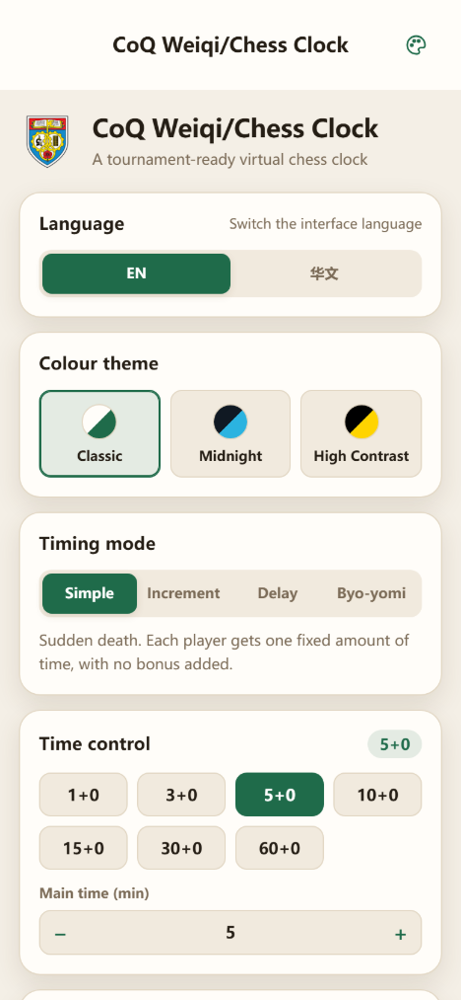


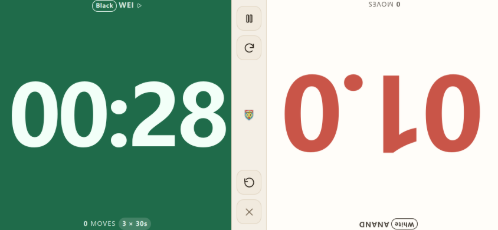
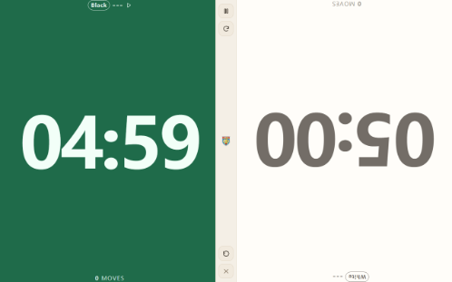

---

## 一、实体棋钟做了什么，本应用复现了什么

在动手写代码之前，先把要复制的设备想清楚是值得的。比赛棋钟并不是「两个秒表」；它是一个带有若干不显然规则的小型状态机。本应用实现的正是这些规则。

| 实体棋钟的行为 | 为什么在比赛中重要 | 本应用中的对应实现 |
| --- | --- | --- |
| 两只**相互联锁**的倒计时器 | 任何时刻只能有一只钟在走，否则双方会不均等地损失时间 | `ChessClock` 计时引擎保证同时只有一方在计时 |
| 按下**自己**那一侧的按钮，自己的钟停、对手的钟开始 | 按钮就是「走棋」这个动作，交接本身就是全部交互 | 点按**自己那一半**显示区 |
| 按错一侧不会有任何反应 | 对手不能靠点按你这边来偷时间 | 点按非活动一侧会被忽略 |
| **步数计数** | 便于裁判复盘对局、发现违规按键 | 每一半各自记录本方的按键次数 |
| **亮旗（超时）** —— 棋钟归零的那一刻 | 直接决定胜负，必须即时且不容误认 | 半屏变红、`TIME OUT` 遮罩、报警音与震动 |
| **费舍尔加秒**（每步 +N 秒） | 现代比赛的标准，鼓励双方继续行棋 | 计时模式 `Increment`（加秒） |
| **布朗斯坦延时**（每步 N 秒免时） | 保护时间紧张但仍在快速行棋的一方 | 计时模式 `Delay`（延时） |
| **包干制** | 对初学者而言最简单的时限 | 计时模式 `Simple`（简单） |
| **读秒**（N 次 × X 秒） | 围棋的加时制度：损失一次读秒只是警告，而不是判负 | 计时模式 `Byo-yomi`（读秒） |
| 裁判用的 RUN / PAUSE 开关 | 处理争议、暂停、棋盘修复 | 暂停按钮，PC 上还可用空格键 |
| 表盘上的**比赛预设** | 没人愿意手工设 90+30 | 每种模式都有预设网格，另可自定义分/秒 |
| 低时间易读性 | 比赛往往就在最后十秒决出 | 剩余 20 秒内切换为十分之一秒，先转琥珀色，再转红并脉动 |
| 平放在**两位选手之间** | 双方都要能正着读到自己那一半 | 横屏或竖屏，第二块显示旋转 180° |
| 电池与不熄屏 | 一局棋中途睡着的手机比没有棋钟更糟 | 屏幕常亮（Wake Lock），并带离线缓存，完全不需要网络 |

有意**未实现**的部分：加拿大式（分段）加时 —— 本应用实现的是日本式读秒；此外还有对局记录、编排配对、棋盘钟，以及可用于等级赛的认证计时精度。

---

## 二、快速开始

### 在 PC 上

直接打开文件即可：

```text
index.html          <- 双击打开
```

或者启动本地服务器，访问它打印出的地址：

```bash
npm install     # 仅在需要 Framework7 源码与开发工具时执行
npm start       # http://localhost:8080
```

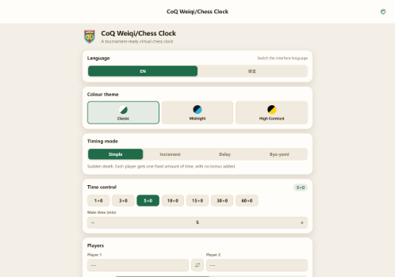

### 在手机或平板上

1. 在 PC 上执行 `npm start` 启动服务器。
2. 服务器会打印所有局域网地址，例如 `http://192.168.1.20:8080`。
3. 在手机上打开该地址 —— 两台设备必须连在同一个 wifi。
4. 用**添加到主屏幕**把它变成全屏、可离线的应用。

### 托管到线上

把整个文件夹（去掉 `node_modules`）上传到任意静态空间即可 —— GitHub Pages、Netlify、内网共享目录，任何能提供文件服务的都行。没有构建步骤，也没有任何服务端代码。放在子目录里同样可用，因为 `index.html` 中的所有路径都是相对路径。

---

## 三、四种计时模式

| 模式 | 行为 | 典型用途 |
| --- | --- | --- |
| **简单（Simple）** | 双方各一份固定时间，不额外加秒。先归零的一方超时。 | 学校与初学者比赛 |
| **加秒（Increment / 费舍尔）** | 刚走完棋的一方获得 +N 秒。加秒在**走完棋之后**入账，与数字棋钟完全一致。 | 3+2、5+3、10+5、90+30 —— 现代标准 |
| **延时（Delay / 布朗斯坦）** | 每一步开始都有 N 秒免时。只有这段免时用完之后主时间才开始走；在免时内落子则主时间分文不减。 | 10+5d、25+5d —— 保护时间紧张的一方 |
| **读秒（Byo-yomi）** | 取自围棋的日本式加时。主时间用完后，每一步都获得一次全新的 X 秒读秒，每位选手持有 N 次。用掉一次读秒只损失这一次机会，而不是判负；该步立即以新的读秒继续。读秒次数用尽即判负。 | 10+3×20s、30+5×30s —— 适合同时开展围棋活动的组织者，或希望加时比突然死亡更温和的场合 |

每种模式都提供预设，也可以手工设定任意主时间（1–180 分钟）与任意加秒（0–600 秒）。所选时限会保存在本机。


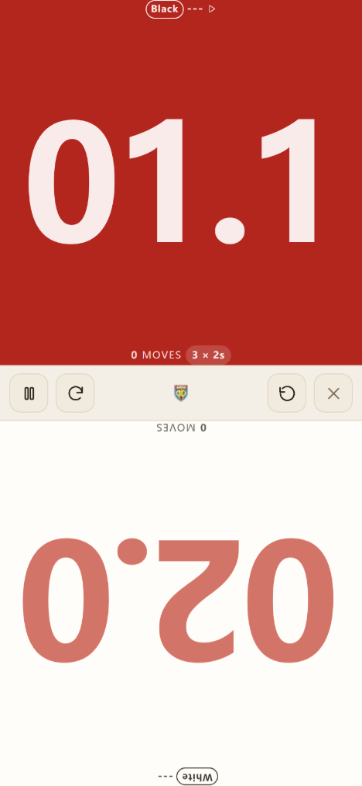
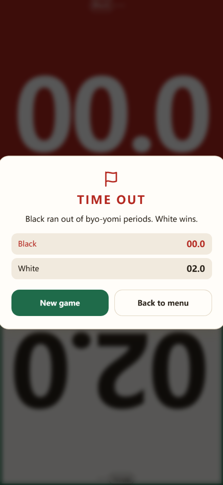

### 棋钟如何做到准确

计时基于单调递增的时间戳（`performance.now()`），而不是累加定时器滴答。这在手机上很关键：屏幕关闭或页面切到后台时，`requestAnimationFrame` 会被完全限流，但页面恢复的瞬间，流逝的真实时间仍然能被正确测量。因此后台运行的棋钟绝不会悄悄多出时间，而屏幕休眠期间发生的超时也会在页面恢复时立即上报。

计时引擎由一套确定性测试覆盖：它用一个假时钟逐步驱动引擎走子 —— 见 `npm test`。

读秒是按围棋棋钟的行为建模的，而不是当作一大块额外时间：选手自己的主时间归零的那一刻就进入加时；读秒次数按人分别计算；某一步中途损失掉的读秒会为这一步重新补满一次；裁判暂停后恢复的是**同一个**读秒，而不是重新发一次。进入加时与每次损失读秒，棋钟都会用不同的提示音告知。

---

## 四、开赛流程

1. 在菜单页选择**语言**、**配色主题**与**比赛时限**。
2. 如需显示姓名就填入；未命名的座位显示 `---`。
3. 选择**先手方** —— 默认黑先（围棋惯例），国际象棋可改为白先。**选手 1** 执该颜色。
4. 把设备平放在两位选手**之间**，保持*面对面旋转*开启，这样两边都能正着读到自己那一半。
5. 按**开始**。先手方的棋钟**立即**开始计时，与按下实体棋钟的 RUN 键完全一致 —— 所以请**先**把设备放好。
6. 轮到谁走棋，就由谁点按**自己那一半**完成交接。点按非活动那一半会被忽略。
7. 裁判中断时用**暂停**；**重置**会停表并回到「点按开始」状态；叉号关闭显示。

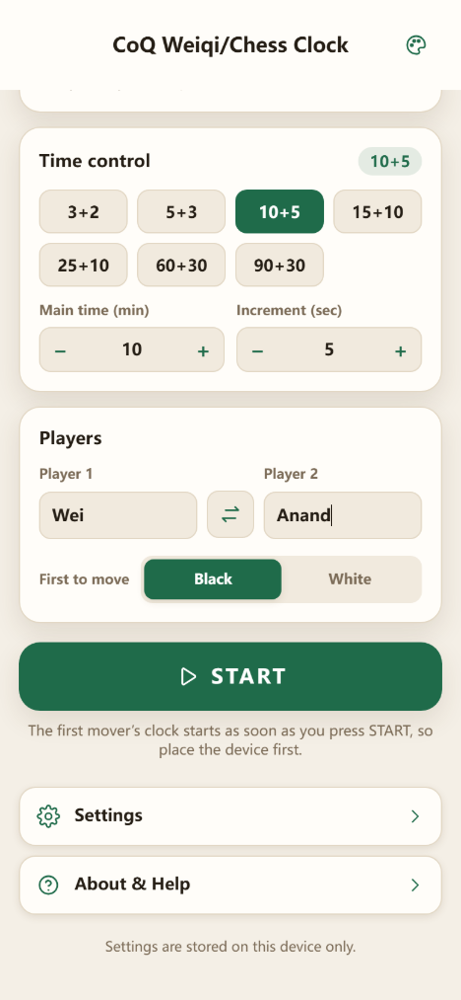

显示区有三种状态：等待点按开始（点**重置**后回到此状态）、计时中、以及裁判中断导致的暂停。


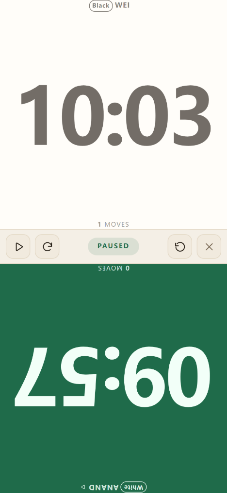

设置页，以及随应用一同发布的帮助页：


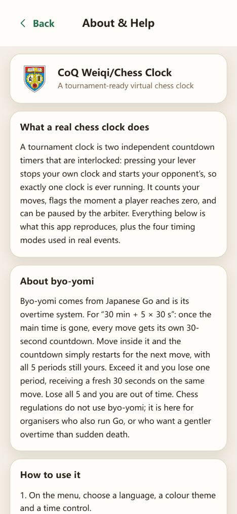

在 PC 上，棋钟打开时这些操作都有对应按键：`A` / `1` / `左方向键` 与 `L` / `2` / `右方向键` 点按某一方，`空格` 暂停，`R` 重置，`F` 翻转显示，`Esc` 关闭。

---

## 五、三项功能需求

### 双语界面（EN / 华文）

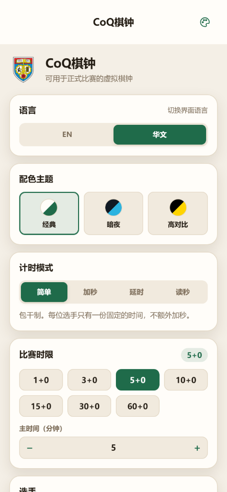

**菜单**页上有一个同时展示两种语言的二段式语言按钮，当前语言为填充状态。其余部分随之切换：菜单、设置、帮助文本、棋钟本身、超时结语，以及数字的格式。选择按设备保存。首次访问会根据浏览器语言列表自动判断，默认回退到英文。所有文案都集中在 `js/i18n.js` 的单一字典里，因此新增第三种语言只需要增加一个对象和一条 `I18n.available` 记录。

### 三套配色主题

| 主题 | 设计意图 |
| --- | --- |
| **经典（Classic）** | 比赛用的象牙白与棋盘绿 —— 白天里的一只木质棋钟 |
| **暗夜（Midnight）** | 近黑底配青色点缀 —— 昏暗的赛场，对 OLED 电池也友好 |
| **高对比（High Contrast）** | 纯黑、纯白、黄色点缀 —— 适合户外光线，也照顾色觉障碍者 |


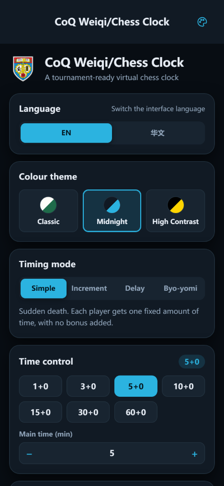


同一块表盘在三套主题下的样子：


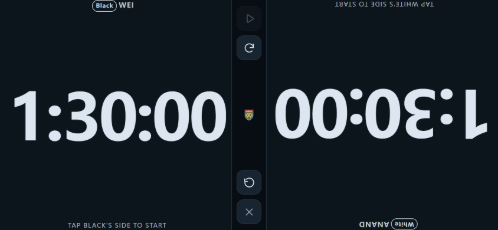
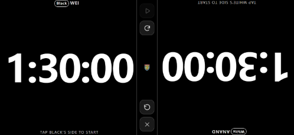

主题完全是一组 CSS 自定义属性，在 `css/app.css` 中每套主题一个代码块；Framework7 自身的变量也被重新映射到同一组令牌上，因此框架的卡片、栏与开关同样跟随主题。新增第四套主题意味着增加一个 CSS 块、一条 `js/themes.js` 记录和一个翻译键。

### 可替换的标志（48×48 与 96×96）

应用只引用**两个**文件：

| 文件 | 尺寸 | 用途 |
| --- | --- | --- |
| `icons/icon-48.png` | 48 × 48 | 浏览器标签图标、1× 标志、棋钟页标记 |
| `icons/icon-96.png` | 96 × 96 | 主屏幕图标、2× 标志（菜单与棋钟）、Web 应用清单 |

部署之后覆盖这两个文件 —— 同名、同尺寸 —— 标签图标、主屏幕图标、菜单标志、棋钟中控条中央的标记以及关于页就会一起更新。无需重新构建，也无需改动代码。细节（包括 maskable 安全区）见 `icons/README.md`。

`npm run icons` 会用 `tools/generate-icons.mjs` 重绘**内置**的默认标志，并且**有意拒绝覆盖已有文件**：只有在你确实想丢弃现有图案时，才执行 `npm run icons -- --force`。

---

## 六、项目结构

```text
myChessClock/
├── index.html                 应用外壳：meta、图标链接、脚本顺序
├── manifest.webmanifest      主屏幕元数据
├── sw.js                      离线缓存（带版本号，发布时递增）
├── css/
│   └── app.css                主题令牌、Framework7 桥接、菜单、表盘
├── js/
│   ├── i18n.js                EN / 简体中文 字典与套用引擎
│   ├── themes.js              三套主题及其持久化
│   ├── platform.js            声音、震动、屏幕常亮、全屏、存储
│   ├── clock.js               计时引擎（不依赖框架，可测试）
│   ├── views.js               每个界面的 HTML
│   └── app.js                 控制器：Framework7、路由、接线
├── icons/
│   ├── icon-48.png            ← 品牌所在：替换这两个文件
│   ├── icon-96.png            ← 即可整体换标
│   └── README.md              如何换标
├── vendor/framework7/        内置的 Framework7（可离线、可从 file:// 运行）
├── tools/
│   ├── serve.mjs              零依赖静态服务器
│   ├── generate-icons.mjs     零依赖绘制默认 PNG
│   ├── vendor-framework7.mjs  从 node_modules 复制发行文件
│   ├── clock-test.mjs         确定性的引擎测试（npm test）
│   └── verify-ui.mjs          在 Chrome 中驱动真实界面并截图
└── docs/screens/              本文档使用的截图，已缩放至 60%
```

一句话概括架构：**`clock.js` 完全不知道 DOM，`views.js` 完全不知道行为，`app.js` 持有状态并把两者接到 Framework7 上。** 正因如此，引擎可以在 Node 里脱离浏览器直接测试。

---

## 七、开发

```bash
npm install          # Framework7 源码 + puppeteer-core（仅开发用）
npm start            # 在 http://localhost:8080 提供服务
npm test             # 87 项计时引擎确定性检查
npm run icons        # 重绘内置默认标志（保留现有图案）
npm run vendor       # 从 node_modules 重新复制 Framework7

node tools/verify-ui.mjs   # 182 项真实 Chrome 界面检查 + 截图存于 .tmp/shots
```

`tools/verify-ui.mjs` 驱动真实浏览器：切换语言与主题、载入 10+5 时限、启动棋钟、点按错误一侧以证明其被忽略、暂停并确认时间真的停住、重置并检查确认门、让一局 1.2 秒的对局超时、完整跑完一局读秒直到读秒次数用尽而超时、在七种屏幕尺寸下检查布局是否恰好铺满视口、走遍每个页面并返回、重新载入以证明设置被持久化，并且只要出现任何控制台错误或请求失败就判定失败。它需要本机装有 Chrome 或 Edge，或设置 `CHROME_PATH`。

两套测试都**比较取值，而不是测试真值性**，因此改动的字符串或过期的预期会让运行失败，而不是悄悄通过。

Framework7 被内嵌在 `vendor/framework7/`，所以应用完全不需要网络，也能直接从 `file://` 运行。升级 npm 包之后，请执行 `npm run vendor`。

---

## 八、部署注意事项

* 若想使用屏幕常亮（Wake Lock，让手机不熄屏），请通过 **https 或 localhost** 提供服务。浏览器会阻止来自其他主机的普通 `http://` 页面使用它；应用会检测到这一点并继续运行，不会出错。
* 发布改动时请递增 `sw.js` 中的 `CACHE` 常量，否则已安装的客户端会一直保留旧的离线副本。
* 如果部署在子目录下，无需任何改动 —— 所有路径都是相对路径。
* 长时间赛事：请开启*保持屏幕常亮*，并带上移动电源。

---

## 九、诚实的局限

* 手机棋钟是**方便的替代方案，而不是经过认证的计时设备**。等级赛应使用经认可的棋钟。
* 浏览器计时每局的误差远小于一秒，但如果操作系统让整台机器进入了睡眠，任何网页都无法测量这段时间。合上笔记本之前请记录双方剩余时间。
* Wake Lock 与震动 API 在部分浏览器中不可用；应用会安静地降级，而不是直接报错。
* 表盘上刻意禁用了双击缩放、文本选择与长按菜单，因为很快就会有两个人在那块屏幕上抢着按。

---

## 十、致谢

Framework7（MIT）提供了应用外壳、路由、弹出层、对话框、开关与分段控件。其余的一切 —— 计时引擎、主题、翻译、表盘与图标生成器 —— 都是本项目的一部分。

以 MIT 许可证分发。
